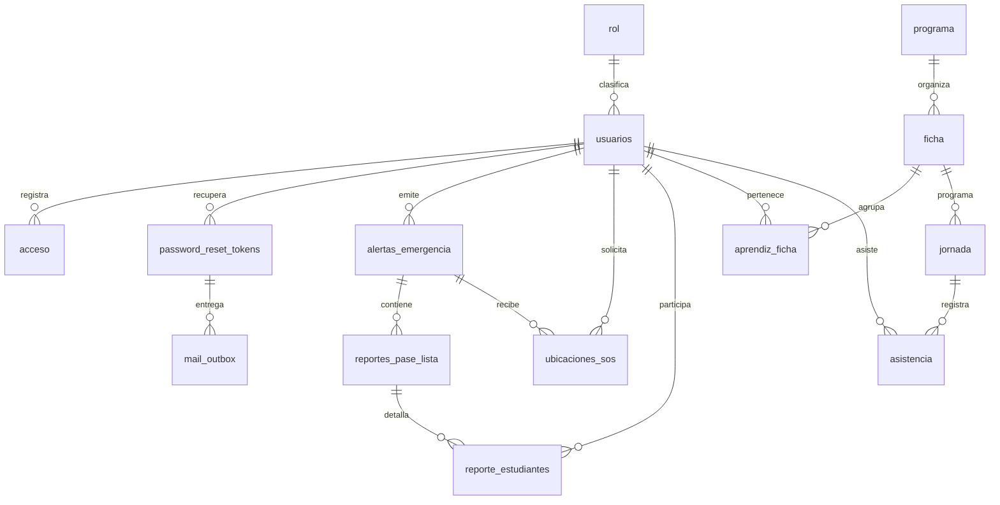

# Auditoría y decisiones

| Hallazgo comprobado                                                                                 | Corrección                                                                                                               |
| --------------------------------------------------------------------------------------------------- | ------------------------------------------------------------------------------------------------------------------------ |
| Backend original Python/FastAPI, no Node.js; no JWT ni controles de rol en las rutas inspeccionadas | API Express nueva con autenticación y autorización centralizadas                                                         |
| Credenciales PostgreSQL incrustadas en `database.py`                                                | Configuración exclusivamente mediante entorno; archivo antiguo respaldado y retirado                                     |
| Contraseñas de usuarios en texto plano y comparación directa                                        | bcrypt con coste 12; contraseñas históricas bloqueadas, recuperación obligatoria                                         |
| Registro permitía enviar el rol desde el cliente                                                    | Registro público fija Aprendiz; creación privilegiada sólo por administrador                                             |
| CORS `*` con credenciales                                                                           | Lista explícita de orígenes; Bearer sin cookies                                                                          |
| SQL adjunto carece de tablas de alertas/recuperación y de varias tablas que usa Python              | Migraciones completas y SQL independiente                                                                                |
| `models.Asistencia` declaraba `id_rol` aunque el SQL y el DOCX lo eliminan                          | API obtiene rol desde usuarios; no exige columna duplicada. En instalaciones antiguas se conserva nullable para revisión |
| DOCX repite claves foráneas y propone TRUNCATE de horarios                                          | No ejecutar esas sentencias; comprobar relaciones en catálogo antes de agregar FK                                        |
| `bd_adiciones.sql` usa tablas aún inexistentes y borra asistencias duplicadas                       | Instalación ordenada y transaccional; duplicados detienen migración sin borrar datos                                     |
| Correo único distinguía mayúsculas/minúsculas                                                       | Normalización e índice único sobre lower(trim(correo)); cadenas vacías pasan a NULL                                      |
| Horas históricas sin zona                                                                           | Conversión a timestamptz desde America/Bogota en accesos y estado histórico                                              |
| Falta de índices para consultar ingresos/relaciones                                                 | Índices en usuario/fecha, historial de alertas y FK                                                                      |
| Reportes guardaban listas de estudiantes en texto sin FK                                            | `reporte_estudiantes` con PK compuesta y FK; texto anterior se conserva sin interpretar por ambigüedad de nombres        |
| Coordenadas flotantes sin rango                                                                     | numeric(9,6), límites geográficos y validación HTTP                                                                      |
| Alertas aceptaban un emisor enviado por el cliente y desactivaban otras automáticamente             | Emisor del JWT, varias activas y cierre individual con historial                                                         |
| No existía canal real de notificación                                                               | SSE con eventos persistidos por triggers y control de visibilidad                                                        |
| Sin restablecimiento de contraseña verificado                                                       | Token aleatorio, hash, expiración, correo cifrado/reintentable, consumo atómico y revocación                             |

El dump original ya contiene claves primarias y las claves foráneas de sus once tablas; no se atribuye a ese archivo una ausencia general de FK. Las migraciones reparan relaciones faltantes en instalaciones parciales y crean las de los módulos nuevos.

Se conserva el historial de asignaciones: no se añade una restricción única global a aprendiz/ficha que impida reingresos legítimos. `estado_aprendiz` permanece como historial. La fecha final de ficha y de asignación no puede preceder a su fecha inicial. Las reglas horarias no afirman resolver solapamientos generales; se impiden duplicados exactos y duraciones no positivas.

No se aplicaron cambios a la base operativa. La restauración de prueba del dump permite validar compatibilidad, no demuestra el estado de una base local que haya cambiado después del respaldo. No se realizaron envíos reales de correo ni pruebas en dispositivos móviles. Las credenciales SMTP, la fuente oficial de emergencias y la integración FCM/APNs dependen del entorno de despliegue.

## Modelo relacional principal

